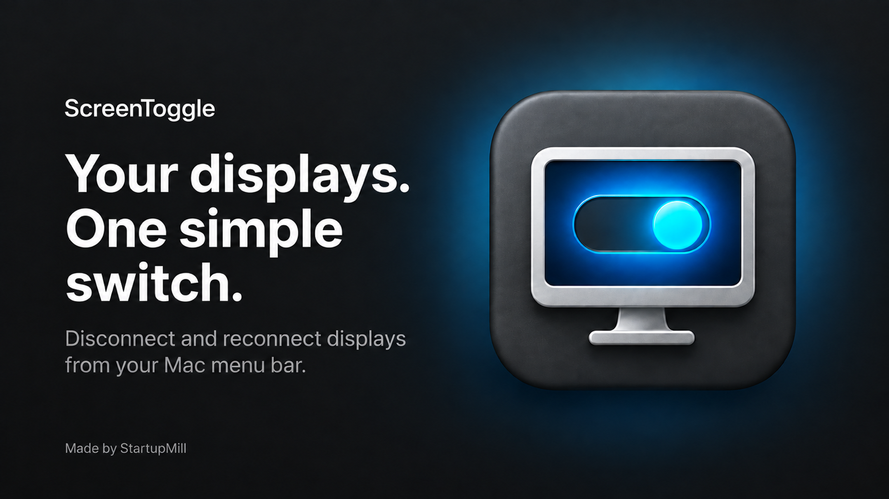
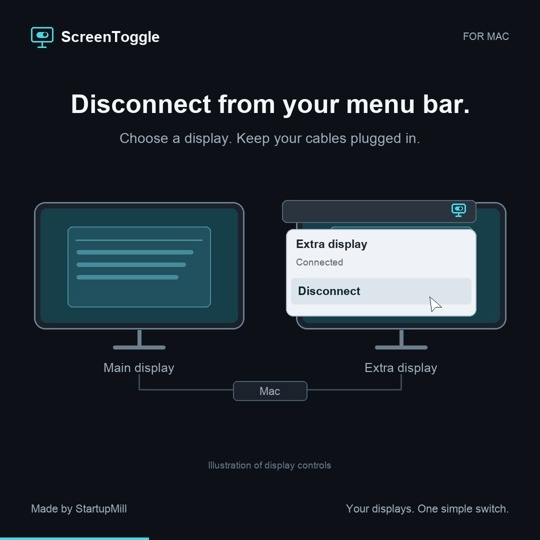
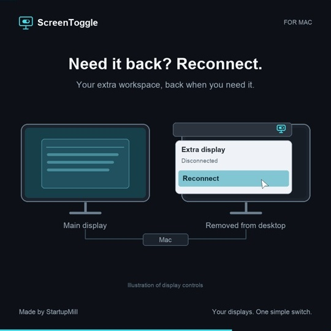

# ScreenToggle

Disconnect and reconnect your Mac's displays from the menu bar, without unplugging cables. ScreenToggle is a small native macOS app from [StartupMill](https://startupmill.co).

**[Visit screentoggle.com](https://screentoggle.com/)** · **[Download ScreenToggle for Mac](https://screentoggle.com/)** · **[Browse releases](https://github.com/StartupMill/ScreenToggle/releases)**

## Download

[Download ScreenToggle 1.1.4 for macOS](https://github.com/StartupMill/ScreenToggle/releases/download/v1.1.4/ScreenToggle-1.1.4-macOS.zip). Requires macOS 13 or later and supports Apple Silicon and Intel.

This is an early-access build signed with Developer ID, but **not notarized by Apple**. macOS may prevent it from opening. See the [release notes](https://github.com/StartupMill/ScreenToggle/releases/tag/v1.1.4) for details and the SHA-256 checksum.

## What it does

- Disconnect and reconnect individual Mac displays without unplugging them.
- Reconnect all displays from the menu bar, with last-screen protection and a timed recovery prompt.
- Use Pro to save up to three display presets and apply them with Apple Focus or Shortcuts.

ScreenToggle releases a display from your Mac; changing to another computer's monitor input depends on your monitor. Display behaviour varies with your Mac, macOS version, monitor and adapter. Mirrored displays are not supported.

## See how it works

Illustrations of disconnecting and reconnecting a display from the menu bar.

| Disconnect | Reconnect |
| --- | --- |
|  |  |

## Install

1. Download and unzip the release.
2. Move ScreenToggle.app to Applications and open it.
3. Use the ScreenToggle icon in the menu bar to manage your displays.

The free app includes manual display controls. [Visit screentoggle.com](https://screentoggle.com/) for details, Pro pricing and support. For help, email [support@startupmill.co](mailto:support@startupmill.co).

## Synergy partnership

Use [Synergy](https://symless.com/synergy?coupon=SCREENTOGGLE&utm_medium=partnership&utm_source=screentoggle) to share one keyboard and mouse across your computers alongside ScreenToggle's Mac display controls. Get 10% off Synergy with code **SCREENTOGGLE**.

This repository provides downloads and release information; it does not contain the app's source code.
